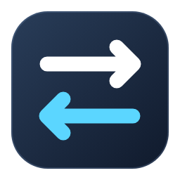
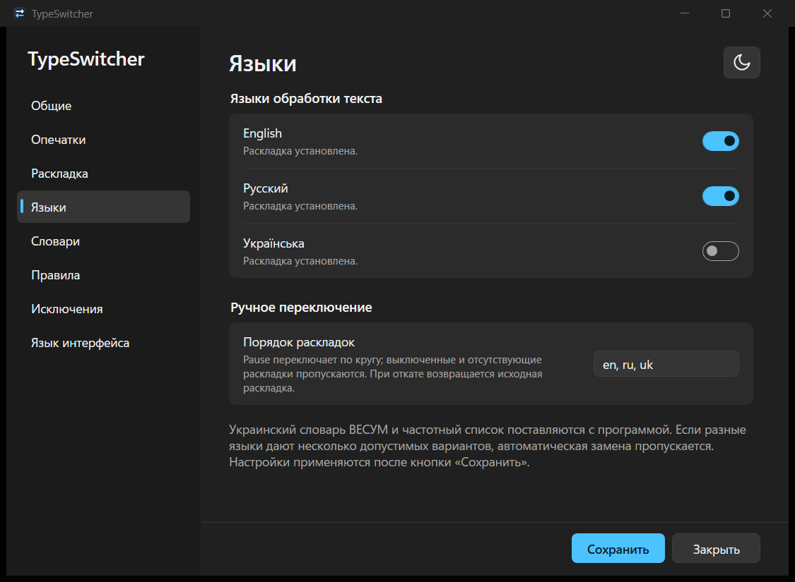
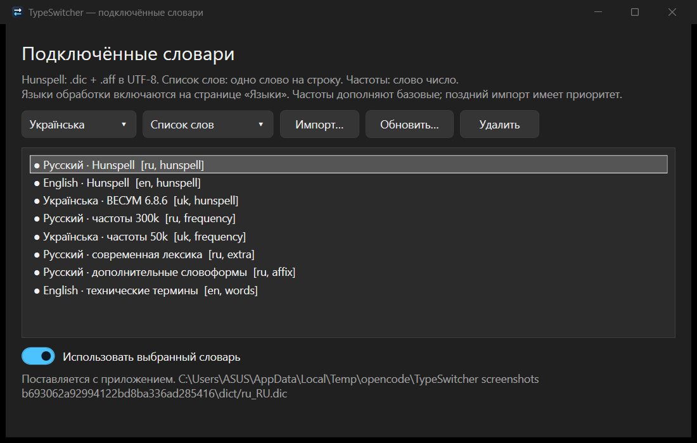

# TypeSwitcher

Фоновый автокорректор для Windows: исправляет опечатки в русских и украинских словах
и переключает раскладку (`ghbdtn` → `привет`, `ghbdsn` → `привіт`). Замена Punto Switcher
без облака, рекламы и телеметрии: всё работает локально, данные не покидают компьютер.

Текущая версия: **2.0.0**. Поддерживаются русский, English (US) и украинский.

**[Скачать для Windows x64](https://github.com/cyberclerkua-cmd/TypeSwitcher/releases/latest)**





## Возможности

- **Опечатки.** Слово, которого нет в словаре, заменяется ближайшим словарным, если
  выбор однозначен. Существует ли слово, решает морфология Hunspell, поэтому редкие
   формы проверяются морфологией; на что менять, решают отдельная модель языка и частота.
- **Раскладка.** Слово, набранное не в той раскладке, перекладывается и раскладка
  переключается. Консервативно: только если в другой раскладке получается настоящее
  слово. Технические токены (USB, GitHub, win10) защищены, слова с одной чужой буквой
  (`привеn`) чинятся, домены и имена файлов (`пщщпдуюсщь` → `google.com`) тоже.
  Слова с буквами на клавишах знаков (`ж`, `б`, `ю`, `х`, `ъ`, `э`) перекладываются целиком
  вместе с пунктуацией: `ghjljk;bnm?` → `продолжить,`.
- **Регистр.** ДВе заглавные в начале слова исправляются сами (`ДВе` → `Две`,
  `THe` → `The`); аббревиатуры и названия вроде `IDs`, `MHz`, `ВКонтакте` не трогаются.
  Shift+Pause меняет регистр набираемого или последнего слова по кругу: строчные,
  ПРОПИСНЫЕ, Первая прописная.
- **Одна клавиша на всё.** Pause откатывает последнюю правку (и возвращает обратно),
  а если правки не было — переключает раскладку набираемого или последнего слова, хоть
  с одного символа, вместе со знаками.
- **Окно слова.** Scroll Lock или несколько откатов подряд открывают у курсора окно:
  «не трогать это слово», «всегда менять на …», своё правило замены. Окно не крадёт
  фокус и закрывается кликом мимо.
- **Свои списки.** Мой словарь (слово правильное), стоп-слова (руки прочь), правила
  (`тлф = телефон`, `;jhbr = жорик`). Общие и языковые списки, импорт и экспорт UTF-8.
- **Подключённые словари.** Импорт Hunspell (`.dic` + `.aff`), списков слов и частот.
  Наборы можно включать, обновлять и удалять. Перезагрузка выполняется в фоне.
- **Украинский.** ВЕСУМ 6.8.6, отдельный частотный список и модель; буквы `і ї є ґ`,
  апострофы `' ’ ʼ`, украинский AltGr, регистр и откат точного варианта раскладки.
- **Исключения.** Поля паролей не трогаются и не запоминаются; чёрный список приложений.
  Окна программ, запущенных от администратора, программа не трогает: Windows не пускает
  туда ввод от обычного процесса.
- **Портабельность.** Одна папка, никакой установки, .NET не нужен. Настройки рядом
  с программой. Автозапуск по желанию.
- **Интерфейс.** Русский, English и українська; светлая, тёмная и системная темы.
  Язык и оформление переключаются сразу, без потери незавершённых правок в настройках.

## Установка

1. Скачайте `TypeSwitcher-2.0.0-win-x64.zip` из раздела [**Releases**](https://github.com/cyberclerkua-cmd/TypeSwitcher/releases/latest) и распакуйте
   в папку с доступом на запись (например, `%LOCALAPPDATA%\Programs\TypeSwitcher`).
2. Запустите `TypeSwitcher.exe`. В трее появится иконка со встречными стрелками.
3. Первый запуск на пару секунд дольше: строится и кешируется языковая модель.

Требуется Windows 10/11 x64. Среда выполнения .NET входит в архив; отдельно устанавливать её не нужно.
Сохраняйте `TypeSwitcher.exe`, библиотеки DLL, `assets/` и `dict/` вместе в одной папке.

Обновление: замените содержимое папки новым архивом, папку `data/` с настройками не
трогайте.

Собрать из исходников: нужен .NET 10 SDK (версия закреплена в `global.json`), дальше
`dotnet build TypeSwitcher.sln`. Портабл-релиз
собирается одной командой `dotnet publish src/TypeSwitcher/TypeSwitcher.csproj -c Release -o dist/TypeSwitcher`
(подробности и служебные режимы — в [docs/INTERNALS.md](docs/INTERNALS.md)).

Локально собранная программа: `dist/TypeSwitcher/TypeSwitcher.exe`. Архив создаёт
`tools/package.ps1`; пользовательская папка `data/` в него не включается.

## Включение украинского

1. Добавьте украинскую раскладку в языковых настройках Windows.
2. Откройте TypeSwitcher → «Настройки» → «Языки».
3. Включите **Українська** и нажмите **Сохранить**. Словарь уже входит в поставку.
4. Порядок ручного переключения задаётся кодами `en, ru, uk`; выключенные и
   отсутствующие раскладки пропускаются.

По умолчанию активны EN/RU. Когда несколько языков дают допустимый вариант
(например, `vfvf` → «мама» в RU и UK), автоматический выбор пропускается.
Pause позволяет выбрать раскладку вручную. Для автоматического исправления важен
язык активного окна. Язык интерфейса выбирается отдельно.

## Язык интерфейса и тема

- **Настройки → Язык интерфейса**: Русский / English / Українська.
- Векторная иконка **солнца, луны или монитора** справа в заголовке настроек открывает выбор темы:
  **Светлая / Тёмная / Системная**. Тот же выбор доступен на странице языка интерфейса.
- В меню иконки трея есть отдельные подменю **Язык интерфейса** и **Тема**.
- Системная тема следует настройке оформления приложений Windows и обновляется при её изменении.

Эти два параметра применяются сразу и сохраняются автоматически. Другие незавершённые
правки остаются в форме до нажатия «Сохранить». Меню, окна, пояснения, подсказки,
доступные имена элементов и собственные сообщения приложения локализованы. Названия
и содержимое пользовательских словарей сохраняют исходный текст; системный файловый
диалог использует язык Windows для своих стандартных кнопок.

## Как пользоваться

- **Иконка в трее**: клик — включить/выключить (серая иконка = выключено), двойной
  клик — настройки, правый клик — меню. Краткая подсветка — только что сработала правка.
- **Pause** — откатить/вернуть правку; для слова без правки — следующая выбранная раскладка.
- **Shift+Pause** — сменить регистр слова: строчные → ПРОПИСНЫЕ → Первая прописная.
- **Scroll Lock** — окно действий для последнего слова.
- Все три клавиши меняются в настройках, раздел «Общие».
- Исправление ДВух заглавных выключается в «Настройки → Опечатки».
- Звуковые сигналы при правке и смене раскладки отключаются там же.

Что делать, если программа упорно правит нужное слово: нажать Pause (правка откатится),
после нескольких откатов всплывёт окно с предложением занести слово в стоп-слова.
Или сразу Scroll Lock. Или вписать слово в «Настройки → Словари».

## Настройки

Открываются двойным кликом по иконке в трее.

| Раздел | Что там |
|---|---|
| Общие | включение, автозапуск, горячие клавиши, звук, окно слова, лог правок |
| Опечатки | включение, минимальная длина слова, допустимое число отличий, выбор замены |
| Раскладка | автопереключение, пороги длины, технические токены, смешанные слова, домены |
| Языки | EN/RU/UK, доступность раскладок Windows, порядок ручного переключения |
| Словари | общий/языковой личный словарь, стоп-слова, импорт/экспорт, подключённые наборы |
| Правила | общие и языковые правила замены `что = на что` |
| Исключения | поля паролей, чёрный список приложений |
| Язык интерфейса | RU/EN/UK для интерфейса, светлая/тёмная/системная тема |

У каждой настройки есть пояснение прямо в окне. Значения по умолчанию подобраны так,
чтобы программа скорее промолчала, чем испортила текст.

## Приватность

Программа не выходит в сеть. Лог правок `data/corrections.jsonl` по умолчанию выключен
и включается в разделе «Общие». Он содержит только события автозамены и откатов — что на
что заменили — без потока набора, паролей и содержимого окон. Нужен, чтобы настраивать
качество на реальных данных, и остаётся на вашем компьютере.

## Данные

Всё лежит в папке `data/` рядом с `TypeSwitcher.exe`: `config.json`, `my_words.txt`,
`stopwords.txt`, `rules.txt`, кеш языковой модели и лог правок. Если `config.json` окажется
повреждён, программа сообщит об этом, запустится с настройками по умолчанию и сохранит копию
испорченного файла как `config.json.broken-<дата>`. Автозапуск прописывает
полный путь к exe в реестр текущего пользователя; после переноса папки включите его заново.

Используется схема настроек версии 2. При чтении старой схемы 1 создаётся `config.json.v1.bak`.
Новые языковые списки: `my_words.uk.txt`, `stopwords.uk.txt`, `rules.uk.txt` и аналогичные
файлы для RU/EN. Старые общие списки продолжают читаться. Чтобы личное украинское слово
участвовало в распознавании раскладки, добавьте его в список **Українська**.
Импортированные наборы находятся в `data/imported/`, модель UK — в `data/ngram_uk.cache`.

## Словари

В папке `dict/`: Hunspell `ru_RU`, `en_US`, `uk_UA`, частотные списки `ru-300k.txt` и
`uk-50k.txt` (FrequencyWords / OpenSubtitles), а также
словари-дополнения проекта:
`ru_extra.txt` и `ru_extra.dic` (современная лексика и англицизмы, которых нет в
Hunspell, второй — с флагами склонения) и `en_extra.txt` (технические токены и
аббревиатуры). Как они устроены и как пополнять — в [docs/INTERNALS.md](docs/INTERNALS.md).

### Подключить свой словарь

«Настройки → Словари → Подключённые словари…»: выберите язык, формат и **Импорт**.

- `hunspell`: `.dic` и соответствующий `.aff`, кодировка UTF-8; проверяется число записей.
- `words`: одно слово на строку; пустые строки и `#`-комментарии допускаются.
- `frequency`: `слово число`; частота не делает неизвестное слово правильным.

Максимум — 64 МБ на файл, миллион записей. Файлы копируются в каталог приложения,
поэтому после импорта исходный файл можно переместить. Изменённый набор подключайте
кнопкой **Обновить**: контрольные суммы проверяются при загрузке. Поставляемые наборы
можно отключать, импортированные — также удалять. Поздний частотный импорт заменяет
частоты совпадающих слов, остальные записи сохраняются.

В личных списках импорт объединяет записи, сохраняя существующие правила при конфликте.
Общие стоп-слова действуют во всех языках; общие правила имеют приоритет над языковыми.
Изменения текста в редакторах применяются кнопкой **Сохранить**.



Происхождение, версии и контрольные суммы: [dict/SOURCES.md](dict/SOURCES.md).

## Известные ограничения

- Имена собственные в чужой раскладке (`fvthbrf` → «америка») автоматически не
  перекладываются: словарь знает их только с заглавной, а расширять правило рискованно.
  Pause переложит вручную, «Мой словарь» научит навсегда.
- Новый Блокнот Windows 11 имеет собственный автокорректор и конфликтует с любым
  внешним; отключите автозамену в его настройках.
- Поддерживаются RU, English (US), UK; другие активные раскладки пропускаются.
- Составные Unicode-графемы распознаются при словарном поиске, но не перенабираются:
  приложения по-разному обрабатывают Backspace для комбинируемых знаков.
- Анализ пословный; неоднозначное окончание вроде `українськй` может быть оставлено
  для ручной правки. При исчерпании бюджета поиска автоправка пропускается.

## Разработка и проверка

```powershell
dotnet restore TypeSwitcher.sln --locked-mode
dotnet test TypeSwitcher.sln -c Release
dotnet publish src/TypeSwitcher/TypeSwitcher.csproj -c Release -o dist/TypeSwitcher
```

Проверка именно опубликованного комплекта: `tools/verify-package.ps1 -Directory dist/TypeSwitcher`.
Служебные режимы: `--selftest`, `--eval --language ru|uk|all`,
`--check привіт привт --language uk`. Отчёты — `%TEMP%/typeswitcher_*.txt`.
Процесс проверок и ручная приёмка: [docs/TESTING.md](docs/TESTING.md).

## Перенос настроек

Переход из другой папки: `tools/migrate-data.ps1 -SourceDirectory <предыдущая-папка>
-DestinationDirectory <новая-папка>`. Инструмент копирует и проверяет данные, не
перезаписывает существующую data/ и сохраняет сведения для обновления автозапуска.
Подробности — в [docs/UPGRADE.md](docs/UPGRADE.md).

## Лицензия

Код проекта распространяется по лицензии
[PolyForm Noncommercial 1.0.0](LICENSE): свободно для личного и любого некоммерческого
использования, коммерческое использование запрещено.

Словари имеют собственные лицензии: см. `dict/hunspell/*.LICENSE`, UK Hunspell — MPL 1.1;
частотные списки — [FrequencyWords](https://github.com/hermitdave/FrequencyWords)
(CC BY-SA 4.0).
